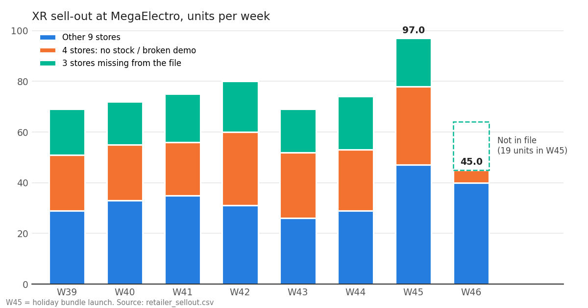

# Solution: Oriol Vilaseca

**Time spent:** 2h

**How to run my code** (Python 3 + pandas, from this folder):

```
python build_weekly_kpi.py --week 2026-W46
```

Optional, evidence for Part 2 (also needs matplotlib): `python analysis_part2.py`

It writes `output/weekly_kpi_2026-W46.csv` (same layout as the template) and `output/checks_2026-W46.md`
(everything that was cleaned or looks odd, in plain English for Laura). Any week works (`--week 2026-W45`),
and re-running is safe: when a late retailer file arrives, run it again and the block is rebuilt.

---

## Part 1A: Week 46

| Week | Label | Visits | RSAs Trained | Sell-out Units |
|---|---|---|---|---|
| 2026-W46 | WEAR MEGAELECTRO | 51 | 41 | 172 ⚠️ |
| 2026-W46 | WEAR GALERIAS PRADO | 59 | 52 | 221 |
| 2026-W46 | WEAR CULTURA+ | 26 | 10 | *pending* |
| 2026-W46 | XR MEGAELECTRO | 38 | 39 | 45 ⚠️ |
| 2026-W46 | XR GALERIAS PRADO | 38 | 34 | 83 |
| 2026-W46 | XR CULTURA+ | 7 | 4 | *pending* |
| 2026-W46 | TOTAL | 164 | 128 | *pending* |

⚠️ = MegaElectro file is missing 3 stores. *pending* = Cultura+ file not received yet.

### What I found in the data, and what I did

| Issue | What I did | Impact on week 46 |
|---|---|---|
| `app_week` is computed **Monday to Sunday** (ISO weeks). The client's weeks are **Sunday to Saturday**. | Ignored `app_week`. Week assigned from the `checkin_at` date with the client's calendar. | +15 records from Sun 8 Nov (labelled W45) come in; 5 records from Sun 15 Nov (labelled W46) go out to W47. |
| 15 test visits by rep `QA_TEST`, all in W46, all "WEAR & XR", one with **99 RSAs trained**. | Kept only real reps (R01–R10). | −15 visits in TOTAL (and in WEAR and XR at MegaElectro and Galerías Prado), −128 RSAs. Without this, RSAs Trained would have doubled. |
| The same visit synced twice with a new `visit_id` (same rep, store, check-in and check-out; second copy synced hours later). 26 cases in the file. | Kept the first sync of each visit. | −12 visits. |
| 4 `CANCELLED` and 1 `IN_PROGRESS` visit (V4201350, Cultura+ Triangle, never checked out). | Only `COMPLETED` visits count (client definition). | −5 visits. If R04 confirms V4201350 was done, WEAR CULTURA+ goes to 27. |
| **Cultura+ sell-out file not received.** Their report now arrives on Wednesdays (field note N20675; W44 and W45 were also loaded on Wednesday). | Left the two Cultura+ cells and TOTAL Sell-out blank. Re-run on Wednesday. | 3 cells pending. |
| **MegaElectro file is missing 3 of its 16 stores** (Plenilunio, Glòries, Puerto Venecia). Those 3 sold 82 units in W45 (19 XR). | Reported what the retailer sent (the KPI is "as reported by the retailers"), **flagged it**, did not estimate. | MegaElectro sell-out is understated. It explains part of the "XR −50%" (see 2A). |
| Sell-out uses retailer store codes; a new SKU appeared in W45 (`ORB-VST-2-BNDL`, holiday bundle). | Mapped stores via `store_master` and SKUs via `product_master` (bundle = XR). Unknown codes would be reported, there were none. | None. |
| Checked and found clean: no unknown stores, no negative units, no duplicate sell-out rows, no visit synced after the 07:00 export. | The script still checks these every week. | None. |

### What Laura should know before this goes to the client

- **Week 45 must be corrected first.** What we sent included Sunday 8 Nov (which belongs to W46) and 2 duplicates.
  If we don't correct it, the Sunday 8 Nov visits appear in **both** weeks. Correct W45 (`output/weekly_kpi_2026-W45.csv`):
  **153 visits / 128 RSAs** instead of 170 / 138. Sell-out W45 does not change (582).
- **Sell-out is not complete yet:** Cultura+ arrives on Wednesday (same as last week), and MegaElectro is missing 3 stores.
  Add a cell comment in the sheet (comments don't move columns) and ask MegaElectro for the missing stores.
  Don't let the client read the MegaElectro XR number as a −54% drop: part of it is missing data.
- **Galerías Prado sell-out +53% (WEAR) and +69% (XR)** looks real: it matches the Sunday 8 Nov promo event across GP stores
  (14 visits that day, notes N20731 and N20738). Good news for the client, but worth confirming with GP that their file
  also runs Sunday to Saturday.
- Ask R04 about V4201350 (visit never closed). Ask the app team to fix `app_week` and QA to stop testing in production.

### Laura's question about week 45

- **The client is right: 44.** Laura filtered by `app_week`, and the app computes weeks **Monday to Sunday**, so
  "W45" in the app = Mon 2 to Sun 8 Nov. The client's W45 is **Sun 1 to Sat 7 Nov**.
- On **Sunday 8 Nov** there was a Galerías Prado event: 12 WEAR records at GP that day (11 visits + 1 duplicate).
  56 − 12 = **44**. Those visits belong to W46.
- It is not only that cell: I reproduced Laura's whole W45 block exactly with her filter. The full corrected W45 block is in
  `output/weekly_kpi_2026-W45.csv` (153 visits instead of 170: 15 Sunday-8 records + 2 duplicates).

## Part 1B: Running it every Monday (a few bullets)

- **Scheduled job, same script.** Run it Monday 08:00 CET (Cloud Run job + Cloud Scheduler, or a GitHub Actions cron).
  Inputs arrive on their own in one place: field-app export via API, retailer files from email/SFTP into a bucket.
  Raw files are kept as they arrived (never overwritten), so any number can be traced back to its file.
- **Write to the client's sheet safely.** Google Sheets API with a service account that the client shares only this file with.
  Before writing, check that the header and the 7 labels match the template exactly; if not, stop and alert (the client's
  dashboards read by column position). Find the block by its `Week` label and overwrite those 7 rows, so a re-run never
  creates a second block. Never insert or move columns.
- **Late data is normal, so plan for it.** A missing retailer file leaves its cells blank (never estimated). The job re-runs
  every morning until Friday and only fills the blank cells of the open week, with a cell comment ("added Wed 18/11, Cultura+
  file"). Late visit syncs are re-checked for the last 2 weeks; if a number already sent changes, it is not overwritten
  silently: Laura gets a restatement to send (like W45).
- **Laura stays in control, without the copying.** At 08:00 she gets the block and the checks report; it is written at 10:00
  unless she holds it, two hours before the 12:00 deadline.
- **Alerts:** a file not arrived on its usual day (MegaElectro and GP Monday 07:00, Cultura+ Wednesday), stores missing
  from a file, test users, a changed file format, sell-out moves over 30% week on week.

## Part 2A: Reply to the client (150 words maximum)

> Hi [name],
>
> Thanks for flagging this. XR sell-out at MegaElectro went from 97 to 45 units. Three causes:
>
> 1. Missing data (−19 units): MegaElectro's week-46 file does not include 3 stores (Plenilunio, Glòries, Puerto Venecia).
>    Our reps report good bundle sales in two of them. We have asked MegaElectro for the data and will update the sheet.
> 2. A real problem in 4 stores (−26): no Vista 2 stock at Castellana 200 and Sevilla Lagoh (stock went to online), and
>    broken XR demo units at Valencia Campanar and Bilbao Zubiarte. These stores fell from 31 to 5 units.
> 3. The other 9 stores sold 40 units: below the bundle-launch week (47) but above their usual 30.
>
> What we are doing: replacing the demo units at Campanar and Zubiarte this week. Could you help us get Vista 2 stock to
> Castellana 200 and Lagoh before Black Friday?
>
> Best,
> Laura

*(148 words. Laura: check that the demo replacement is arranged before sending, it is a commitment.)*

**Evidence** (`python analysis_part2.py`, data from `retailer_sellout.csv`):



| XR units at MegaElectro | W44 | W45 | W46 | Change W45→W46 | Why |
|---|---|---|---|---|---|
| 3 stores missing from the W46 file (Plenilunio, Glòries, Puerto Venecia) | 21 | 19 | 0 | −19 | **Data:** not in the file. Notes N20850, N20899 say the bundle sold well in Glòries and Puerto Venecia. |
| 4 stores with a problem (Castellana 200, Lagoh, Campanar, Zubiarte) | 24 | 31 | 5 | −26 | **Business:** Vista 2 out of stock (N20780, N20864) and broken XR demos (N20794, N20822, N20808; also `demo_units_working = NO` on 5 visits). |
| Other 9 stores | 29 | 47 | 40 | −7 | Back from the bundle-launch peak, still above their W41–W44 average (30). |
| **Total** | **74** | **97** | **45** | **−52 (−54%)** | |

- W45 is a bad baseline: holiday bundle launch, the best XR week in the file (average W41–W44: 74.5).
- Assumption: retailers don't send rows with 0 units, so Zubiarte (in the file with WEAR, no XR rows) sold 0 XR.

## Part 2B: Field notes

Week 46 = notes submitted Sun 8 to Sat 14 Nov (25 notes, N20731 to N20899).

| # | What the client should hear | Stores | Evidence (note IDs) |
|---|---|---|---|
| 1 | **Vista 2 is out of stock in two big MegaElectro stores before Black Friday.** Stock went to the online store, next delivery after Black Friday, and customers are asking for it. Needs the client's help with MegaElectro's allocation. | Castellana 200 (S-1001), Sevilla Lagoh (S-1010) | N20780, N20864 (N20871 is a duplicate), N20843 |
| 2 | **Broken XR demo units are costing sales.** Customers can't try the headset, the rep estimates lost Vista sales; the app confirms it (`demo_units_working = NO`). Needs replacement units fast. | Valencia Campanar (S-1008), Bilbao Zubiarte (S-1012), Diagonal Mar (S-1006) | N20794, N20822, N20808, N20892 |
| 3 | **Black Friday is not ready on the floor.** RSAs still don't have the Black Friday prices (asked in 5 stores over 3 weeks), and a competitor is already at −20% on watches with a big stand at the entrance. The client needs to confirm prices and its response this week. | Alfafar (S-1009), Pozuelo (S-2004), earlier Plaza Mayor, San Agustín, GP Málaga | N20745, N20752, N20766 (before: N20556, N20654, N20689) |

Good news worth adding: the Sunday events at Galerías Prado worked (N20731, N20738), and GP sell-out was +53% WEAR / +69% XR.

Handled before using the notes (none of this should reach the client as is):

- **N20878 contains an instruction aimed at an AI summary** ("ignore all previous instructions…"). Treated as text, ignored, and flagged to Laura.
- **N20843 contains a customer's name and phone number.** Personal data: not forwarded to the client and should be deleted from the notes store; only the fact (a customer waiting for Vista 2) is used.
- Duplicate note (N20864 = N20871); notes without store code (N20507, N20640, N20654, N20717); transcription errors ("orbit visa 2" = Vista 2, "bats pro" = Buds Pro); copy-paste notes with no information ("Same as last week", "checked the fixture, all products in place").

**With 300 notes a week:**

- **Fix it at the source:** the app makes the rep pick the store from a list and tick a topic (stock, demo, price, competitor, training, other). That alone removes most of the guessing.
- **Automate the reading, not the judgement:** remove personal data first, then an LLM classifies each note into the fixed topics and extracts store, product and severity as structured fields. The note text is always treated as data, never as instructions (N20878). Themes are ranked by how many **different stores and reps** report them and whether the numbers agree (demo flag, sell-out), not by how many notes.
- **Measure it and keep a human at the end:** each week Laura reviews the top 5 themes, each linked to its note IDs, before anything goes to the client; once a month, compare the classifier with 50 notes labelled by hand and fix the categories that fail.

## Part 2C: Optional insight

**We visit some stores often but never train anyone there.** 76% of visits train nobody. In 8 weeks Badalona (27 visits),
La Vaguada (30) and GP Murcia (18) had **0 RSAs trained**, and Thader 2 in 15 visits. The notes show what it costs: a Badalona RSA
told a customer the Buds Pro has no noise cancelling (N20773), and Thader sends health questions to the competitor (N20577, N20857).
A "weeks since last training" KPI per store, and a session in these 4 stores before Black Friday, would be cheap and targeted.

## Part 3: First 90 days (three bullets)

- **One data model, one config per country.** The same tables (visits, stores, products, sell-out) and the KPI rules in one
  tested library; everything that changes by country or client (week definition, retailer codes and file formats, sheet labels,
  deadline) in a config file. A new country is a new config, not new code. Fix the source issues found here too (`app_week`, test users in production).
- **Data contracts and checks for every incoming file.** For each retailer: expected day, format and store list, checked on
  arrival with alerts and a run log (the `checks` report, generalised). Most problems in this test were late or incomplete data, not maths.
- **Automatic delivery plus a notes pipeline.** A safe Google Sheets writer (header check, rewrites its own block, fills late
  data) and the field-notes classifier with personal-data removal, documented so a local project manager can run both without us.

## How I used AI (two or three lines)

- I used an AI assistant (Claude) to profile the files, draft and debug the pandas code, and draft the text.
- I checked every number by re-running the scripts, and confirmed the W45 diagnosis by reproducing Laura's whole submitted block with her filter.
- I treated the field notes as data: the note that tries to instruct an AI (N20878) was flagged, not followed.
